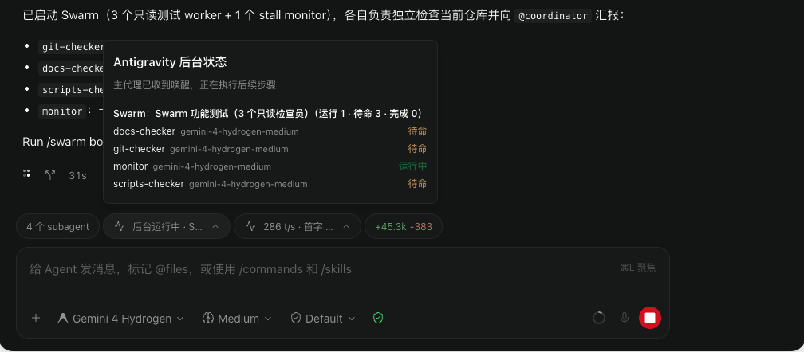

# antigravity-lifecycle (Paseo plugin)

Integrates Antigravity CLI (`agy`) lifecycle hooks with Paseo and adds a live composer pill (`Antigravity 后台状态`) showing active `swarm` members, `invoke_subagent` runs, background `run_command`/`schedule` tasks, and `/goal` status.



> 下面是中文说明，内容以中文为准。

为 Antigravity CLI（`agy`）安装 Paseo 生命周期 hook（`~/.gemini/config/hooks.json` 的 `"paseo-status"` 分组），把 `Stop`（含官方 `fullyIdle: true | false` 与进程 `pid`）写入 `<brainDir>/.system_generated/logs/hook-state.json`、`PreInvocation` / `Stop` 的进程号写入 `process.json`，并在 Paseo 输入框上方提供 `Antigravity 后台状态` 实时胶囊（覆盖原生 `swarm`、`invoke_subagent` 与后台 `run_command` / `schedule`）。

## 为什么需要这个插件

1. `agy acp` 在前台第一轮调用结束时常提前返回 `{ stopReason: "end_turn" }`（含 `swarm_wait` 首次被唤醒、或 `Stop` hook 落盘前 ~1.75s 的竞争窗口），让 Paseo 界面显示为 `idle`。
2. 本插件服务端每 2s 轮询活动中的 `antigravity` / `antigravity-cli` 会话磁盘状态（并校验证件 `pid` 存活，已退出或已归档会话立即清零），通过 `addComposerPill` 在桌面端、Web 端与手机端实时展示 `后台运行中` 胶囊与成员详情 Popover，**无需重启 Paseo daemon**，热重载即可生效。

## Hook 分组

在不改动 `"orca-status"` 与 `"thread-scope"` 的前提下，在 `~/.gemini/config/hooks.json` 维护独立的 `"paseo-status"` 命名分组：

1. `PreInvocation`：输出 `{}`，记录 `process.json`（不覆盖 `hook-state.json` 的 `Stop` 信号）。
2. `PostInvocation`：输出 `{}`，不覆写 `Stop` 结果。
3. `Stop`：输出 `{"decision":""}`，原子写入 `hook-state.json`（`fullyIdle: true | false` + `pid`）与 `process.json`。

## 安装与验收

```bash
cd paseo-plugins/antigravity-lifecycle
npm install
npm run typecheck
npm test
paseo plugin reload antigravity-lifecycle
paseo plugin ls                   # 要求 antigravity-lifecycle = running
```
